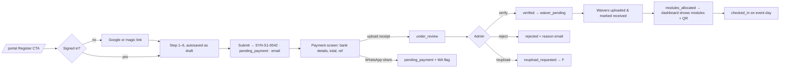

# Synaxis S1: Phase 1 Plan

Written 2026-11-25. The organisers asked for the plan and every build phase in one go,
with assumptions flagged instead of stopping for approval. Every guess is marked
**⚑ ASSUMPTION** and gathered in §11 so it can be checked in one sitting.
`docs/BRIEF.md` is the source of truth for requirements. This file covers the *how*.

---

## 1. Research summary

### 1.1 Logo (`/public/logo/`)
- The original is 1080×1080 RGBA with transparent padding. Trimmed, the wordmark is
  890×126 (about a 7:1 strip).
- **Colours (sampled):** grey `#737375` for the letters, red `#D82934`/`#DC2A35`
  for the X, and a darker red edge `#BA1E27` from anti-aliasing.
- **Letterforms:** wide, heavy and monoline, with flat horizontal cuts at the
  terminals. Outer corners are large, generous radii (S, A, N), inner counters are
  tight and square, and the Y is a single curved hook. The **X is two mirrored
  chevrons**, the strongest motif in the mark. It reads as a "crossing" or "gathering"
  (σύναξις means "gathering"). It also looks like two thruster flames, which is why
  the Baymax thruster, the page transitions and the loader all reuse the chevron.
- **Implication:** the display font should be wide, heavy and geometric with soft
  outer corners. Rounded "bubble" fonts don't fit the mark. Techy-wide fonts do.

### 1.2 Instagram (@heusersynaxis)
Not accessible to automated tools. **⚑ ASSUMPTION:** the posts use the same grey and
red as the logo, white or near-white space and sans-serif display type. When the
organisers' screenshots arrive, revisit §3 (accent ratios) and §4 (fonts) only. The
token architecture won't need to change.

### 1.3 KGSO (kgso.net, Tally forms)
| KGSO does | Borrow? | Synaxis does better |
|---|---|---|
| Single-page site: Home/countdown → About → Modules → Schedule → Legacy → FAQ → Contact, with separate Sponsors/Vendors pages | Yes, the structure works | Modules get real cards and detail pages; KGSO's list is buried in a PDF guidebook |
| Two separate Tally forms (internal / external) | No | One form; delegation type is step 1 and branches the rules |
| Head Delegate fills the whole form | Yes | Plus autosave and resume across devices |
| Fee total **emailed later** | No | Instant fee breakdown on the review step and the payment screen |
| Payment proof via a separate form, waiver via a Google Doc link | No | Receipt upload and waiver upload in-site, private storage |
| No status tracking | No | Live dashboard: status timeline, what's missing, deadlines |
| "Skip intro" countdown overlay delays content | Partly | Intro only on `/`, shorter on repeat visits; `/portal` loads instantly |
| FAQ omits the regular rate; sponsors are "To be announced" | No | FAQ and fees come from the same settings row, so they can't disagree |
| Email-only sponsor contact | No | Sponsor inquiry form, stored and emailed to admins |

### 1.4 Big Hero 6 reference library (the source for §7 and §8)
- **Baymax:** healthcare mode (vinyl, inflation, scan, chest display, "On a scale of
  1 to 10…", "I am satisfied with my care", low-battery droop, "hairy baby", fist bump
  "ba-la-la-la-la", red charging case). Armour mode (red plates with purple trim,
  thrusters, rocket fist, HUD).
- **Hiro:** microbots, neurocranial transmitter, garage lab, blueprints, "Look for
  another angle".
- **Tadashi:** SFIT cap, his lab, the "bot fight" origin.
- **Go Go:** maglev discs, speed, yellow/black. "Woman up."
- **Wasabi:** plasma blades, neat grids, "There's a place for everyone".
- **Honey Lemon:** chem purse, chem balls (pink/yellow/blue), sticky foam.
- **Fred:** kaiju suit, fire breath, comics.
- **Callaghan / Yokai:** kabuki mask, microbot swirl, portal rings, Krei Tech.
- **Places and objects:** San Fransokyo (torii Golden Gate, lanterns, sakura, wind
  turbine blimps), Lucky Cat Café, Mochi the cat, SFIT showcase.

**Asset policy:** all character visuals are **original vector silhouettes and motifs**
drawn for this project (simple geometric Baymax, maglev discs, chem balls, kabuki
mask outlines). No film stills. `public/assets/CREDITS.md` records the origin of
everything.

---

## 2. Moodboard directions
| | A. "Healthcare Kit" | B. "San Fransokyo Night" | **C. "Hiro's Garage" (chosen)** |
|---|---|---|---|
| Feel | Clinical, soft, white | Neon city, lanterns, dusk | A warm workbench lit by a coral glow: blueprints by day, armour HUD by night |
| Pros | Very calm, accessible | High drama | Fits both modes, admin and public naturally; blueprint grids work as skeleton loaders |
| Cons | Loses the "olympiad" energy | Heavy imagery, slow on phones | Needs restraint so the grids don't get busy |

**Choice: C,** with A as the light mode skin and a pinch of B (torii, lanterns) in
section dividers only. **⚑ ASSUMPTION**, revisit with the Instagram screenshots.

---

## 3. Palette and tokens

### 3.1 Ramp logic
The two reds are **one ramp**: coral `#F24B59` is red-500 (action) and the logo
red `#DC2A35` is red-600 (pressed/logo/Battle accent), with red-700 `#C42634` for red
text on light backgrounds. Using them as neighbours on one ramp makes the pairing
look intentional.

### 3.2 Contrast facts that drove the choices
| Pair | Ratio | Decision |
|---|---|---|
| White on coral `#F24B59` | 3.54 ❌ | Coral buttons use **ink `#0B1220` text (5.28 ✅)** |
| Navy `#18243A` on coral | 4.38 ⚠️ | Large text only |
| White on deep red `#DC2A35` | 4.74 ✅ | Pressed button: deep red + white |
| Deep red on off-white | 4.36 ❌ | Red text on light uses red-700 `#C42634` (5.25 ✅) |
| Logo grey `#737375` on off-white | 4.34 ❌ text / ✅ UI | Borders/HUD only; secondary text uses grey-600 `#5F5F63` (5.83) |
| Logo grey on dark bg | 3.96 | Borders only; secondary text uses grey-300 `#9A9AA0` (6.69) |
| Indigo `#424CBC` on dark bg | 2.67 ❌ | Dark-mode indigo text uses indigo-300 `#8B93F0` (6.71) |
| Coral on `#0B1220` | 5.28 ✅ | Coral works as text in Battle Mode |

### 3.3 Tokens (implemented in `src/app/globals.css` as CSS variables)
| Token | Peaceful Medical (light) | Battle (dark) |
|---|---|---|
| `--bg` | `#F7F5F0` | `#0B1220` (new: deeper navy) |
| `--surface` | `#FFFFFF` | `#18243A` (navy) |
| `--surface-2` | `#EFECE5` | `#1F2D47` |
| `--ink` (text) | `#18243A` | `#F7F5F0` |
| `--ink-muted` | `#5F5F63` | `#9A9AA0` |
| `--line` (borders/HUD) | `#D9D5CC` / `#737375` strong | `#2A3955` / `#737375` strong |
| `--primary` | `#F24B59` | `#F24B59` |
| `--primary-ink` (text on primary) | `#0B1220` | `#0B1220` |
| `--primary-press` | `#DC2A35` (+ white text) | `#DC2A35` (+ white text) |
| `--primary-text` (red as text) | `#C42634` | `#FF6B77` |
| `--accent` (indigo) | `#424CBC` | `#8B93F0` |
| `--logo-red` | `#DC2A35` | `#DC2A35` |
| `--logo-grey` | `#737375` | `#9A9AA0` (letters lightened for contrast) |
| `--glow` | none | `0 0 24px rgb(242 75 89 / .35)` |
| `--radius` | `20px` ("inflated") | `10px` (panel cut) |
| success / warning / danger | `#1F8A5B` / `#B26A00` / `#C42634` | `#4ADE9A` / `#FBBF24` / `#FF6B77` |

**Character accents** (used for card edges, chips and glows, never as body text
colour without a check): Baymax `#F24B59`, Honey Lemon `#FF5FA2`, Go Go `#F5C400`,
Tadashi `#3B82F6`, Hiro `#7C5CFF`, Wasabi `#2BB673`, Callaghan `#8A8F98`,
Fred `#2FB8AC`, Yokai `#DC2A35` with a black/white kabuki mask.

---

## 4. Typography
| Role | Font | Why |
|---|---|---|
| **Display** | **Unbounded** (variable, 600–900) | Wide, heavy and geometric with large outer radii and flat cuts, the closest Google-hosted match to the logo's S/A/N. Variable weight keeps it to one file |
| **Body** | **Plus Jakarta Sans** | Very legible at 14–16 px on phones, slightly rounded terminals (soft for Medical mode without being bubbly) |
| **Mono/HUD** | **JetBrains Mono** | Counters, registration IDs, Battle Mode labels, countdown digits |

All three load through `next/font/google` (self-hosted at build time, Latin subset,
`display: swap`). Headings use `letter-spacing: -0.01em`. Labels in Battle Mode are
uppercase mono at 0.08em tracking. The Baymax Guide's speech bubble uses the body
font at 600 weight with a fully rounded bubble. **⚑ ASSUMPTION:** revisit when the
Instagram screenshots show the actual post fonts.

---

## 5. Sitemap, flows and wireframes

### 5.1 Sitemap
```
/                    Landing intro (microbot assemble → "Enter the portal")
/portal              Main page: Hero+countdown · About · Modules · Register teaser · FAQ
/modules/[slug]      Module detail
/council             Cabinet
/sponsors            Tiers + inquiry form
/register            Sign-in gate → 6-step form → submit
/dashboard           Head Delegate: status, payment, receipt, waivers, modules, QR
/admin               Overview stats
/admin/teams         Table + drawer (verify/reject/reupload)
/admin/allocation    Module allocation tool
/admin/content/*     Modules · FAQs · Council · Sponsors · Settings
/admin/emails        Bulk email
/admin/checkin       QR scanner + attendance
/admin/audit         Audit log
/login, /auth/callback, /not-found (pain scale 404)
```

### 5.2 Head Delegate flow


### 5.3 Admin flow
```mermaid
flowchart LR
  S[Sign in] --> R{role}
  R -- super_admin --> ALL[Everything]
  R -- finance --> P[Teams table → receipt preview → verify/reject/reupload → audit + email]
  R -- module_head --> MH[Teams in own modules (read) · edit own module content]
  ALL --> AL[Allocation: auto by preference+capacity, Kabuki compulsory, manual tweak, notify]
  ALL --> EX[Exports CSV/XLSX] & CM[Content] & EM[Bulk email] & CI[Check-in]
```

### 5.4 Wireframes (mobile-first, 375 px)
```
/portal (mobile)                    /register step 4 (mobile)
┌───────────────────────────┐       ┌───────────────────────────┐
│ ▣SYNAXIS   ◐  [Register]  │       │ ▮▮▮▮▯▯ Battery 4/6         │
├───────────────────────────┤       │ Module preferences        │
│  SYNAXIS                  │       │ ┌───────────────────────┐ │
│  Season 1 · 15–17 Jan     │       │ │🔒 Kabuki Caper  COMPUL│ │
│  ┌──┐┌──┐┌──┐┌──┐ countdn │       │ └───────────────────────┘ │
│  │49││12││03││55│         │       │ Pick & rank 3–4 more:     │
│  [ Register your team → ] │       │ 1 ≡ Baymax's Blueprint  ✕ │
├───────────────────────────┤       │ 2 ≡ Maglev's Mayhem     ✕ │
│ ABOUT  ...                │       │ 3 ≡ Wasabi's Wits       ✕ │
├───────────────────────────┤       │ + Add: [Lemon's][Hangar]..│
│ MODULES                   │       │                           │
│ ┌─────────┐┌─────────┐    │       │ [Back]        [Continue →]│
│ │Baymax's ││Lemon's  │    │       │                 (Baymax ◕)│
│ │Blueprint││Labyrinth│    │       └───────────────────────────┘
│ └─────────┘└─────────┘ …  │
├───────────────────────────┤       /dashboard
│ HOW TO REGISTER 1-2-3-4   │       ┌───────────────────────────┐
│ Fees table                │       │ Team Microbots SYN-S1-0042│
├───────────────────────────┤       │ ● Submitted ● Paid ○ Waiv │
│ FAQ  ▸ ▸ ▸                │       │ Total Rs 14,500  [Pay →]  │
├───────────────────────────┤       │ Receipt: ▢ drop / WhatsApp│
│ Footer: contact · 🐱wave  │       │ Waivers: 0/5 [Upload]     │
└───────────────────────────┘       │ Modules: — after verify   │
                                    └───────────────────────────┘
```

---

## 6. Data, security, storage, email

### 6.1 Schema (`supabase/migrations/`)
| Table | Key columns |
|---|---|
| `profiles` | id (= auth.users.id), email, full_name, created_at |
| `user_roles` | user_id, role (`super_admin`/`finance`/`module_head`), module_id nullable |
| `module_categories` | id, name, sort |
| `modules` | id, slug, name, subject, character, accent, motif, short_desc, description, format, team_size_note, schedule_slot, head_name, cohead_name, capacity, is_compulsory, is_active, sort, category_id |
| `teams` | id, reg_no (serial), reg_code (`SYN-S1-0042`, generated), owner_id, team_name (unique, case-insensitive), delegation_type, head_* fields, institution, city, grade, guardian_*, heard_from, needs, consents jsonb, status, wa_shared_at, submitted_at, edit_locked |
| `team_members` | id, team_id, position, full_name, email, phone, grade, institution, is_head |
| `module_preferences` | team_id, module_id, rank (compulsory stored with rank 0) |
| `module_allocations` | team_id, module_id, allocated_by, allocated_at |
| `payments` | id, team_id, amount, fee_breakdown jsonb, receipt_path, method (`upload`/`whatsapp`), status, verified_by, notes, created_at |
| `waivers` | id, team_id, member_id nullable (null = combined), file_path, received, received_by |
| `registration_drafts` | owner_id pk, data jsonb, step, updated_at (cross-device autosave) |
| `faqs`, `council_members`, `sponsors`, `sponsor_inquiries` | content |
| `settings` | single row id=1: fees, deadlines, team_min/max, modules_min/max, bank jsonb, contact jsonb, registration_open, announcement, internal_email_domain |
| `email_logs`, `audit_logs`, `checkins` | logs, check-in day/module/by |

Fees are **computed in SQL** (`compute_fee(member_count, at)`) so the client display,
the email and admin always agree. The client shows the same formula for instant
feedback, but the submitted amount is the server's.

### 6.2 RLS plan
- `is_staff()`, `has_role(r)`, `is_module_staff(module_id)` are `security definer`
  helpers that are `stable` and `search_path=''`.
- **Public read:** active modules, categories, FAQs, council, sponsors, settings
  (non-secret columns only; bank details are exposed only through a
  `get_payment_details()` RPC for signed-in team owners).
- **Owner:** a team owner can read their team, members, preferences, allocations,
  payments and waivers, and can insert/update only while `registration_open` and the
  status allows it. Status changes go **only through server actions** using the
  service role, after checking permissions and writing to the audit log.
- **Staff:** super_admin full access; finance can read teams/payments/waivers and
  update payments; module_head can read teams that have an allocation or preference
  in their module, and update only their module's row.
- `audit_logs`, `email_logs`: staff read, no client writes.
- `sponsor_inquiries`: anyone can insert (rate-limited server action), staff read.

### 6.3 Storage (private buckets, signed URLs ≤ 10 min)
- `receipts/{team_id}/{timestamp}.{ext}`: image/PDF, ≤ 5 MB
- `waivers/{team_id}/{member_id|combined}-{ts}.pdf`: ≤ 10 MB
- `council/`, `sponsors/`: **public** buckets for photos and logos (not sensitive)

Owners upload to their own team folder. A policy checks the folder against the
team they own.

### 6.4 Emails (Resend + React Email, themed "Baymax chest display" cards)
| Trigger | Template |
|---|---|
| Submit | `registration-received` (ID, breakdown, bank details, deadline) |
| Receipt uploaded | `receipt-received` |
| Verified | `payment-verified` ("I am satisfied with my care") |
| Rejected / reupload | `payment-rejected` / `reupload-requested` (with the admin's reason) |
| Waivers complete | `waivers-received` |
| Modules allocated | `modules-allocated` (list + dashboard link) |
| Sponsor inquiry | `sponsor-inquiry` (to admins) |
| Bulk | `broadcast` (subject + markdown body; templates: payment reminder, waiver reminder, schedule update) |

If `RESEND_API_KEY` is missing, emails are written to `email_logs` with status
`skipped` so local and dev setups work without it.

---

## 7. Effects spec
Timing defaults: micro ≤ 200 ms, UI ≤ 300 ms, scenes ≤ 1.2 s (intro ≤ 4.5 s, skippable).
**RM** = `prefers-reduced-motion` fallback.

| # | Element | BH6 reference | Timing | RM fallback | Ships in |
|---|---|---|---|---|---|
| 1 | Landing intro | Microbot swarm assembles the logo, forms a gateway, parts on Enter | 4.5 s first visit / 1.5 s repeat | Static logo + Enter button | Step 3 |
| 2 | Section headings | Microbot mesh resolves into the text, ripples on hover | 900 ms, once in view | Plain text | Step 3 |
| 3 | Scroll progress | Armoured Baymax flying, thruster ∝ scroll velocity, lands at the footer | continuous | Thin coral rail with a static Baymax at % | MVP: rail · Step 3: Baymax |
| 4 | Page transitions | Microbot swarm wipe (CSS view transition with a dotted mask) | 350 ms | Instant | Step 3 |
| 5 | Scroll reveals | "Maglev slide": elements glide in on a disc with speed lines | 400 ms | None | MVP (simple) |
| 6 | Primary button | Medical: vinyl inflate (scale 1.03, squash on press 0.97 × 1.02). Battle: armour panel glow | 160 ms | Colour change only | MVP |
| 7 | Tap feedback | Microbot burst: 6 dots scatter from the tap point | 250 ms | None | MVP |
| 8 | Loader | Baymax charging battery (cells filling) | loop 1.2 s | Static "Charging…" text | MVP |
| 9 | Form step progress | Baymax battery meter, 1 cell per step | 300 ms | Instant | MVP |
| 10 | Skeletons | Hiro's blueprint grid lines drawing in | 1.2 s loop | Static grid | MVP |
| 11 | Field focus | Healthcare scan line sweeps the field | 250 ms | Focus ring only | MVP |
| 12 | Validation error | Medical: "Scan complete" hint chip. Battle: red HUD bracket flash | 200 ms | Static message | MVP |
| 13 | Success | Fist bump + "ba-la-la-la-la" sparkles; "I am satisfied with my care" | 900 ms | Static ✓ + text | MVP |
| 14 | Toasts | Baymax chest display: rounded screen slides out of a red case | 220 ms | Fade-free appear | MVP |
| 15 | Modals/drawers | Baymax inflating out of the charging case (scale-y from the bottom, rounded) | 260 ms | Instant | MVP |
| 16 | Tooltips | Guide speech bubble with tail | 150 ms | Instant | Step 3 |
| 17 | Selects | Go Go maglev disc chips slide out | 180 ms | Instant | MVP |
| 18 | Theme toggle | Baymax suits up: armour plates snap on (Medical→Battle) / come off | 450 ms | Instant swap | MVP (icon) · Step 3 (full) |
| 19 | FAQ accordion | Wasabi plasma blade: a green-white line slices open the panel | 260 ms | Instant | MVP |
| 20 | Link underline | Wasabi plasma line draws in | 180 ms | Static underline | MVP |
| 21 | Card hover | Hiro lab hologram tilt + character colour scanline | 200 ms | Border colour only | MVP |
| 22 | Module card flip | Signature move per character (chem pop, maglev spin, plasma slash, fire breath, kabuki swirl…) | 500 ms | Swap content without rotation | Step 3 |
| 23 | Countdown | SFIT/Krei digital display, segmented digits tick | 1 s | Same, no tick animation | MVP |
| 24 | Cursor (desktop) | Faint microbot trail | continuous | Off | Step 5 |
| 25 | Empty states | Mochi asleep, "Nothing here yet" | — | — | MVP |
| 26 | Drag-to-rank | Microbots joining a chain: linked dots between ranked cards | 200 ms | Static numbers | MVP |
| 27 | Receipt upload | Honey Lemon purse: receipt floats out, folds back on success | 1.2 s | Plain drop zone | MVP: plain · Step 3: purse |
| 28 | Admin | Hiro's garage: blueprint grid bg, HUD labels, quieter versions of 6/8/10/14 | — | — | MVP |
| 29 | Baymax Guide | Wave/point/fist bump, squash-and-stretch on appear/click | 300–700 ms | Static pose | Step 3 |
| 30 | Copy-to-clipboard (ref ID) | Microbot "data port" blink | 400 ms | Text "Copied" | MVP |

---

## 8. Easter eggs
| # | Egg | Trigger | Ships |
|---|---|---|---|
| 1 | Fist bump "ba-la-la-la-la" | Konami code | ✅ |
| 2 | Pain-scale 404 | Any 404 | ✅ |
| 3 | Mochi peeks | Random section edge, ~1 in 4 page views | ✅ |
| 4 | "Hairy baby" | Type `hairy baby` anywhere: a fuzz overlay on Baymax/logo for 3 s | ✅ |
| 5 | Lucky Cat Café | Footer cat waves on hover/tap | ✅ |
| 6 | Fred's kaiju | Idle 25 s on FAQ: kaiju doodle stomps along the bottom | ✅ |
| 7 | "Look for another angle" | Third failed attempt on the same field | ✅ |
| 8 | Low-battery Baymax | 60 s inactivity: guide droops | ✅ |
| 9 | Wasabi straightens | A slightly tilted sticker in About straightens on hover, "There's a place for everyone" | ✅ |
| 10 | Tadashi's cap | Hidden in the Hamada's Hangar card art | ✅ |
| 11 | Console message | DevTools banner for CS students, hint about the rest | ✅ |
| 12 | Secrets tracker | `found X/12`, unlocks a downloadable Instagram story card (canvas PNG) | ✅ |

---

## 9. Build order (from the organisers)
1. **MVP** (target ≤ 2 weeks): scaffold, tokens, main page, both modes, auth, full
   registration, fee calc, payment screen (upload + WhatsApp), emails, admin verify +
   exports.
2. **Admin depth:** allocation, waivers, bulk email, CMS, audit log, council, sponsors.
3. **Signature effects.**
4. **Event-day:** QR check-in, attendance.
5. **Easter eggs, polish, perf, a11y.**

---

## 10. Open questions for the organisers
1. Fees: delegation fee and per-delegate rates (early/regular)?
2. Dates: registration open, early-bird cutoff, registration close, payment deadline?
3. Venue (campus name/address, map link)?
4. Bank details (bank, account title, account number, IBAN) and a WhatsApp number for
   receipts?
5. Module categories: are there any category rules beyond "Kabuki Caper is
   compulsory"?
6. Module capacities (teams per module)?
7. Internal email domain for Heuser students?
8. Contact email and WhatsApp numbers for the footer.
9. Minimum teams for "Best Overall Institute"?
10. Council names, roles, photos and socials.
11. Waiver template PDF.
12. Domain name for the site and the Resend sending domain.

## 11. Assumptions register (⚑, all editable in admin unless noted)
| # | Assumption | Where to change |
|---|---|---|
| A1 | Fees: delegation Rs 4,500; per delegate Rs 2,500 early / Rs 3,500 regular (KGSO values as placeholders) | Admin → Settings |
| A2 | Registration opens as soon as the site is deployed (opens_at 2026-11-25, gated by the "registration open" toggle), early bird ends 2026-12-15, closes 2027-01-08, payment deadline 2027-01-11 (all 23:59 PKT) | Admin → Settings |
| A3 | Team 4–6 incl. head; modules 4–5 incl. Kabuki | Admin → Settings |
| A4 | Early bird/regular is decided by **submission time**, not payment time | Code: `compute_fee` |
| A5 | Module capacity default 40 teams each; Kabuki uncapped | Admin → Modules |
| A6 | Internal email domain `heusercollege.edu.pk` (taken from the organiser's account domain) | Admin → Settings |
| A7 | No module category rules besides the compulsory flag | Admin → Modules |
| A8 | WhatsApp share keeps status at `pending_payment` (flagged) until the receipt is actually checked by finance | Code |
| A9 | Waivers: either one combined PDF or per member; "complete" = combined received or all members received | Code |
| A10 | Check-in QR is per team (one code); per-member QRs can be added later | Code |
| A11 | Bank details, contact info and venue are placeholders | Admin → Settings |
| A12 | Fonts: Unbounded / Plus Jakarta Sans / JetBrains Mono until Instagram screenshots arrive | `src/app/fonts.ts` |
| A13 | Moodboard C "Hiro's Garage" | Design tokens |
| A14 | First Super Admin is set by SQL/seed (`scripts/make-admin.sql`); later admins are assigned in Admin → Roles | Admin |
| A15 | Times are shown in Asia/Karachi | Code |

---

## 12. Implementation status (2026-11-25)
All five build steps are implemented and tested locally. See README.md for setup and deployment.

| Step | Status | Verified by |
|---|---|---|
| 1 MVP | ✅ | E2E: magic-link sign-in → 6-step registration → `SYN-S1-0001` → receipt upload (private bucket) → admin verify; unit tests; production build |
| 2 Admin depth | ✅ | Waiver tick → status recompute; allocation preview/apply/notify; settings edit refreshes the public site (cache tags); exports CSV/XLSX |
| 3 Signature effects | ✅ | Microbot intro (full/short/skip/reduced motion), microbot headings, Baymax flight, Baymax Guide, Honey Lemon purse, microbot page dissolve, suit-up theme wipe, card flips |
| 4 Event day | ✅ | QR (native BarcodeDetector or jsQR fallback) + manual ID check-in, duplicate detection, per-day/module attendance |
| 5 Eggs & polish | ✅ | 12 secrets + story card; Lighthouse mobile: `/portal` perf 93, `/` perf 94; accessibility 100 on audited pages in both modes; RLS suite 16/16 |

### Deviations from the plan (and why)
- **Fees are computed in TypeScript (`src/lib/fees.ts`), not SQL.** The client preview, the
  server submission and the emails share one function, and the server stores the result on the
  team. Same guarantee, simpler to unit-test.
- **Selects stay native** (no animated "maglev disc" dropdowns). Native pickers are much better
  on phones and with screen readers. The maglev motif appears in reveals, chips and the module
  ranker instead.
- **Baymax animation is SVG + CSS, not Lottie/Rive.** No extra runtime and no asset pipeline;
  poses (wave/point/fist), squash-and-stretch and low-battery droop are built in.
- **Tooltips:** the site has almost none; guidance goes through the Baymax Guide's speech bubble.
- **Page transitions** use React `<ViewTransition>` (Chromium 125+, recent Safari/Firefox).
  Other browsers simply swap pages.
- **Registration opens immediately** (`registration_opens_at` 2026-11-25) behind the admin
  "Registration open" switch, per "go live ASAP".
- **Check-in QR is per team** (A10). The QR encodes `/admin/checkin?t=<token>`, so a staff
  phone camera opens the scanner page directly.
- **WhatsApp payments:** the team stays `pending_payment` until finance records the payment
  with "Record & verify" in the team drawer (A8).

### Still needed from the organisers (see §10)
Real fees and dates, bank details, venue, contact numbers, council members and photos,
module heads, capacities, Instagram screenshots (to confirm fonts and palette), the official
waiver PDF (or keep `/waiver`), and the production domain + Resend sending domain.
